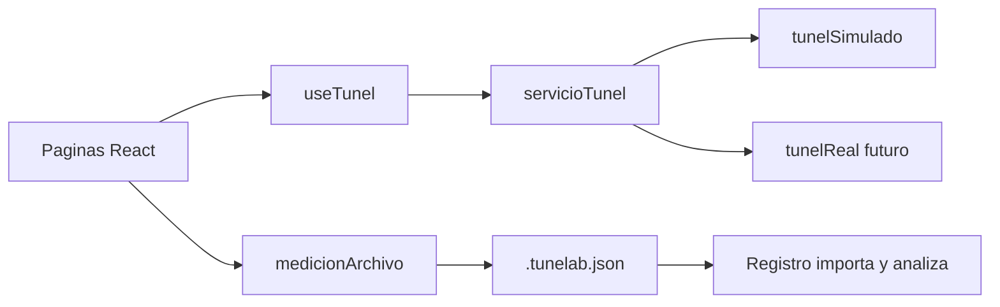

# Guia tecnica de estudio de Tunelab

Esta guia explica la version simplificada del proyecto `nuevo_tunelviento_app`.
Esta pensada para estudiar y defender el TFG sin mezclarla con la version antigua
que tenia backend y base de datos.

## 1. Que es la aplicacion

Tunelab es una aplicacion web de laboratorio para:

- preparar una ficha temporal de ensayo
- operar o simular el control del tunel
- visualizar el tunel en 3D
- capturar una medicion
- descargar la medicion como archivo
- volver a abrir ese archivo para revisar datos

La decision importante de esta version es que no guarda historico en una base de
datos propia. El resultado de una medicion se conserva en un archivo `.tunelab.json`.

## 2. Arquitectura general



La interfaz habla con `useTunel`. `useTunel` se conecta a `servicioTunel`. Segun
la variable de entorno, `servicioTunel` usa el simulador o el adaptador real.

## 3. Carpetas principales

| Carpeta | Para que sirve |
|---|---|
| `src/pages` | Pantallas principales: Dashboard, Ensayo, Control, Registro e Inspeccion. |
| `src/components` | Piezas reutilizables: barra lateral, barra superior, visor 3D y graficas. |
| `src/components/control` | Paneles que componen la pantalla Control. |
| `src/servicios/tunel` | Estado del tunel, simulador y adaptador real futuro. |
| `src/servicios/archivos` | Crea y lee archivos `.tunelab.json`. |
| `src/styles` | CSS de la app. |
| `public` | Recursos estaticos como modelos o texturas. |
| `docs` | Documentacion de estudio y decisiones tecnicas. |

## 4. Archivos que debes dominar

### `src/App.jsx`

Controla que pagina se muestra. Tambien mantiene el usuario local provisional y
el aviso global verde.

En esta version no hay login propio. El usuario local representa que, en el futuro,
el acceso vendra desde UACloud u otro sistema institucional.

### `src/servicios/tunel/useTunel.js`

Es el puente entre React y el servicio del tunel.

La idea es:

- suscribirse al estado del tunel
- actualizar React cuando cambie la telemetria
- exponer `estadoTunel`, `accionesTunel` y `fuenteTunel`

### `src/servicios/tunel/index.js`

Elige la fuente activa:

- `simulado`
- `real`

Por defecto usa simulacion. Si en el futuro se define `VITE_FUENTE_TUNEL=real`,
usara `tunelReal.js`.

### `src/servicios/tunel/tunelSimulado.js`

Simula el comportamiento del tunel.

Hace cosas como:

- encender y apagar el tunel
- cambiar potencia
- iniciar y detener mediciones
- generar muestras de velocidad, temperatura y potencia
- crear resumenes
- mantener una ficha temporal de ensayo

Es importante decir que no representa hardware real, sino un entorno de desarrollo.

### `src/servicios/tunel/tunelReal.js`

Es el adaptador futuro al tunel fisico.

Ahora no controla hardware. Esta preparado para que, cuando se sepa como leer la
DAQ o mandar comandos al variador, se complete aqui sin redisenar la interfaz.

### `src/servicios/tunel/estadoTunel.js`

Define la estructura comun de datos.

Aqui viven funciones para:

- crear el estado base
- limitar valores
- crear ensayos temporales
- crear mediciones
- calcular resumenes
- formatear tiempos
- resumir alarmas

Este archivo es importante porque define el contrato interno de la app.

### `src/servicios/archivos/medicionArchivo.js`

Es una de las piezas mas importantes de la version simplificada.

Hace dos trabajos:

- convertir una medicion en un documento `.tunelab.json`
- leer un `.tunelab.json` importado por el usuario

El archivo contiene:

- datos del ensayo
- datos de la medicion
- resumen estadistico
- tabla de muestras
- eventos
- version del formato

## 5. Pantallas principales

### Ensayo

Archivo:

```text
src/pages/PaginaEnsayos2.jsx
```

Sirve para preparar la ficha temporal del ensayo. Pide:

- nombre
- objetivo
- descripcion

Limites actuales:

- nombre: 30 caracteres
- objetivo: 40 caracteres
- descripcion: 200 caracteres

La ficha no se guarda como historico. Se usa para la medicion actual y se incluye
despues dentro del archivo exportado.

### Control

Archivo:

```text
src/pages/PaginaControl2.jsx
```

Es la pantalla operativa.

Permite:

- encender/apagar el tunel
- ajustar potencia
- ajustar objetivos
- iniciar medicion
- detener medicion
- ver telemetria
- ver recap final
- descargar el archivo de medicion

El diseño se compone con:

```text
src/components/control/PanelesControl2.jsx
```

### Registro

Archivo:

```text
src/pages/PaginaRegistro2.jsx
```

Ya no es una base de datos visual. Es un visor/importador de archivos.

Permite:

- cargar uno o varios archivos `.tunelab.json`
- seleccionar un archivo cargado
- ver resumen
- ver graficas
- ver tabla completa de muestras
- ver eventos

Cuando cierras la app, esos archivos cargados desaparecen del visor. No se pierden
si el usuario los tiene guardados en su carpeta, UACloud, Moodle o USB.

### Dashboard

Archivo:

```text
src/pages/PaginaDashboard2.jsx
```

Muestra una vista de supervision:

- estado general
- telemetria
- avisos
- modelo 3D ligero
- acceso rapido a Control y Registro

### Inspeccion

Archivo:

```text
src/pages/PaginaInspeccion.jsx
```

Muestra el modelo 3D del tunel con etiquetas. La parte importante para defender
es que el modelo GLB se coloca en una escena 3D con React Three Fiber y Three.js.

Esta pagina debe cuidarse porque el 3D consume recursos. Por eso Dashboard usa un
modo mas ligero y carga el visor con pequeno retraso.

## 6. Flujo completo de una medicion

1. El usuario entra en `Ensayo`.
2. Rellena nombre, objetivo y descripcion.
3. La app crea una ficha temporal en `estadoTunel`.
4. La app pasa a `Control`.
5. El usuario ajusta potencia y objetivos.
6. El usuario pulsa iniciar medicion.
7. El simulador o adaptador real empieza a generar/recibir muestras.
8. El usuario detiene la medicion.
9. Se calcula un resumen.
10. Control muestra el recap.
11. El usuario descarga el `.tunelab.json`.
12. En Registro, el usuario carga ese archivo.
13. Registro lo interpreta y muestra graficas, tabla y eventos.

## 7. Por que este enfoque es defendible

Es defendible porque reduce complejidad sin perder trazabilidad.

Ventajas:

- no necesitas mantener usuarios propios todavia
- no dependes de Docker, PostgreSQL ni migraciones
- no guardas datos personales en un servidor propio
- cada medicion queda en un archivo legible
- la app puede volver a leer esos archivos
- la conexion real queda separada del guardado de resultados

Limitaciones:

- no hay historico central automatico
- si el usuario pierde el archivo, pierde la medicion
- no hay auditoria completa
- no hay permisos internos por rol
- no hay sincronizacion entre equipos

Estas limitaciones son aceptables si se explican como decision de alcance para el TFG.

## 8. Que decir sobre el simulador

Frase recomendada:

> El simulador no pretende sustituir al tunel real. Sirve para desarrollar y validar
> la interfaz, el flujo de medicion y el formato de exportacion mientras la conexion
> fisica se define aparte.

## 9. Que decir sobre el tunel real

Frase recomendada:

> La app esta preparada para sustituir la fuente simulada por una fuente real mediante
> `tunelReal.js`. La interfaz consume un contrato comun, por lo que la integracion
> fisica se concentra en un adaptador y no obliga a rehacer las pantallas.

## 10. Que estudiar primero

1. `src/App.jsx`
2. `src/servicios/tunel/useTunel.js`
3. `src/servicios/tunel/estadoTunel.js`
4. `src/servicios/tunel/tunelSimulado.js`
5. `src/servicios/archivos/medicionArchivo.js`
6. `src/pages/PaginaEnsayos2.jsx`
7. `src/pages/PaginaControl2.jsx`
8. `src/pages/PaginaRegistro2.jsx`
9. `src/pages/PaginaInspeccion.jsx`

Si entiendes esos archivos, puedes defender la arquitectura principal.
